# FIR Studio — FPGA DSP Accelerator & Verification Workbench

**Design the filter. Control the hardware. Verify every result.**

[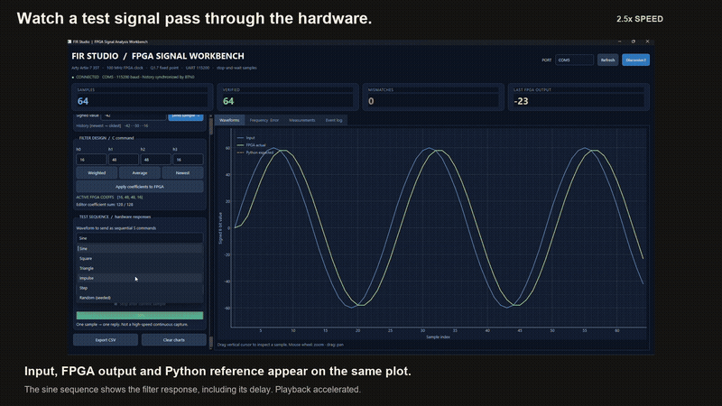](demo/FIR-Studio-Final-Showcase.mp4)

**[▶ Watch the full 1:52 project video](demo/FIR-Studio-Final-Showcase.mp4)** · [Smaller web video](demo/FIR-Studio-Web.mp4) · [Build & run](docs/BUILD-AND-RUN.md) · [Results](docs/RESULTS.md) · [Original report](docs/reports/original-project-report.pdf)

A programmable **four-tap FIR filter on an Artix-7 FPGA**, paired with a Python desktop workbench that sends samples, changes coefficients, plots returned results and checks them against a software reference.

**SystemVerilog · FPGA DSP · Fixed-point arithmetic · Pipelining · Vivado · UART · Python · PySide6 · pyqtgraph**

## The problem and the solution

A sequence of numbers can contain rapid fluctuations that obscure its underlying trend. A finite impulse response (FIR) filter combines recent samples with selected weights to shape that signal. In this project, the arithmetic runs in custom FPGA logic, while a desktop application makes the hardware easy to control and verify.

The PC supplies digital test samples through USB-UART. The FPGA filters each sample and returns a result. FIR Studio plots input and output, calculates its own expected answer, and flags mismatches. This is a digital hardware demonstration; it does not use an external analogue sensor or ADC.

## See the complete system

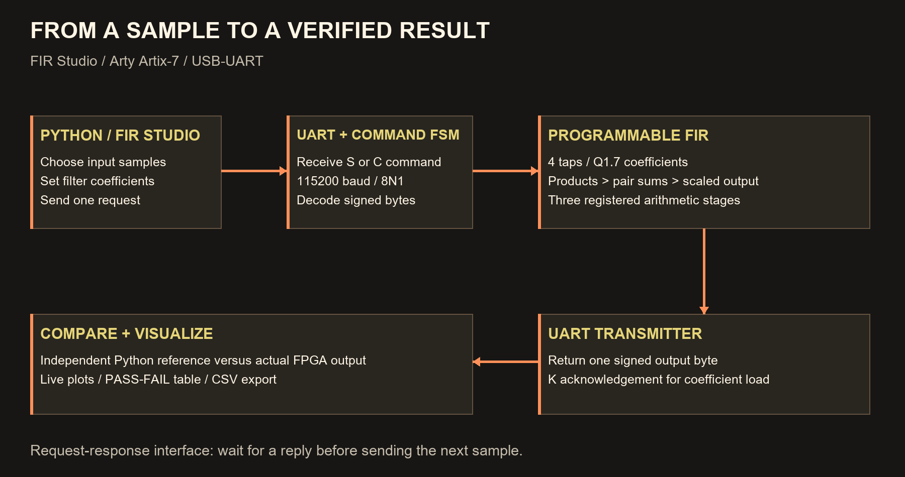

| Layer | Implementation |
|---|---|
| Hardware | Digilent Arty Artix-7 35T; target `xc7a35ticsg324-1L` |
| DSP core | Four taps, signed 8-bit samples, signed Q1.7 coefficients |
| Datapath | Three registered stages: products → partial sums → output |
| Configuration | Runtime coefficient updates; no bitstream rebuild for new weights |
| Interface | Custom UART RX/TX and command FSM, nominal 115200 baud, 8N1 |
| Desktop | Python, PySide6, pyqtgraph, NumPy and PySerial |
| Verification | RTL testbenches, Python reference vectors and physical FPGA comparisons |

## Development journey

### 1. Start with the filter mathematics

The first design calculated a four-sample moving average. The signed fixed-point version introduced weighted coefficients:

```text
total = H0*x[n] + H1*x[n-1] + H2*x[n-2] + H3*x[n-3]
output = signed_8_bit(total >>> 7)
```

Default coefficient integers `[16, 48, 48, 16]` represent weights `[0.125, 0.375, 0.375, 0.125]`. For newest-to-oldest samples `[32, 24, 16, 8]`, the result is `20`.

The shift implements division by 128. Negative fractional results round toward negative infinity; output overflow wraps to signed 8-bit rather than saturating. See [arithmetic details](docs/ARCHITECTURE.md).

### 2. Pipeline and program the RTL

The fixed filter was split into three registered arithmetic stages. Valid signals travel with the data so the testbench can compare outputs at the correct clock edges. The programmable version stores four coefficient registers that the host can update.

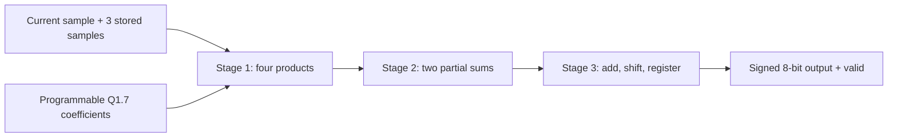

### 3. Synthesize and inspect resource usage

Vivado converts the RTL into FPGA resources. The screenshot below shows the fixed-coefficient pipelined design with **58 LUTs and 87 registers** and synthesis complete.

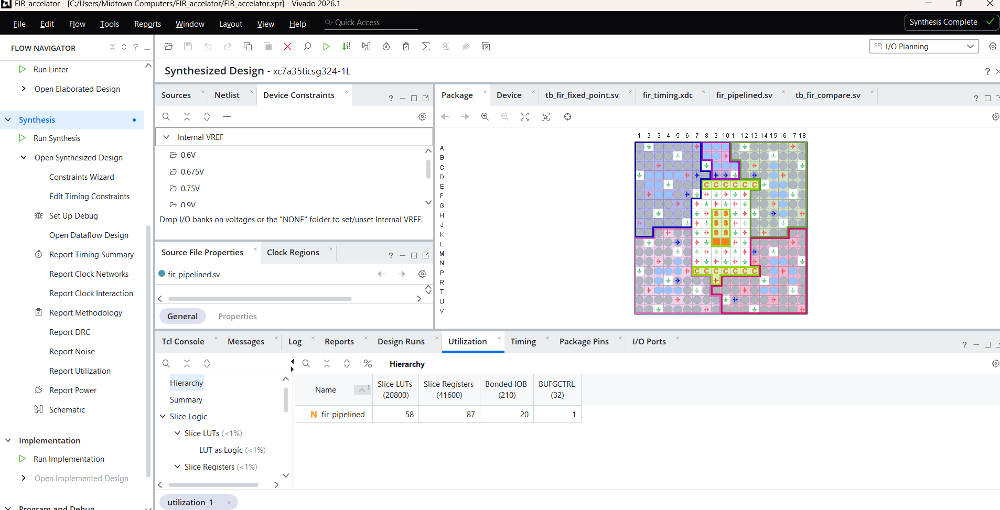

### 4. Compare timing and resource tradeoffs

The earlier standalone designs share the same FPGA target and **10 ns clock constraint**. These are **post-synthesis** measurements:

| Metric | Fixed baseline | Fixed pipelined | Programmable pipelined |
|---|---:|---:|---:|
| LUTs | 51 | 58 | 153 |
| Registers | 33 | 87 | 96 |
| Setup WNS | +3.190 ns | +5.576 ns | +4.230 ns |

Pipelining increased setup timing margin by **2.386 ns (74.8%)**, at a cost of **7 LUTs and 54 registers**. This is an increase in timing margin, not a 74.8% clock-speed or throughput increase.

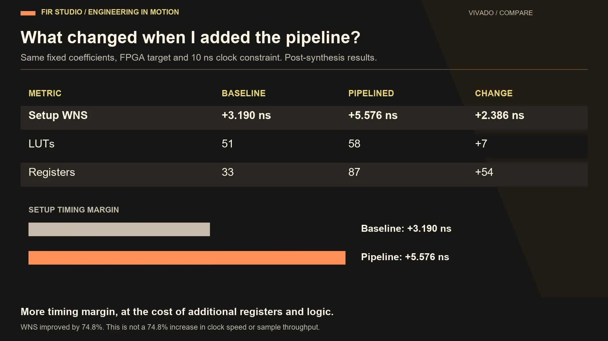

<details>
<summary>Open the original Vivado timing screenshots</summary>

**Fixed baseline**

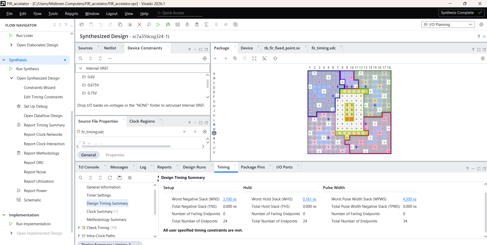

**Fixed pipelined**

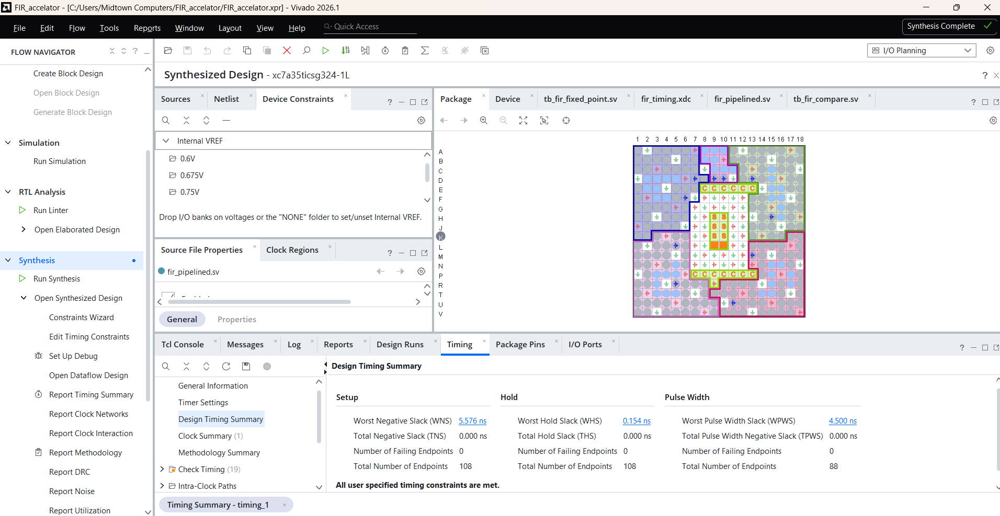

</details>

### 5. Verify serial communication in simulation

The UART loopback test sends ASCII `A` and checks that it comes back. The actual Vivado screenshot shows RX/TX waveforms and the passing console result.

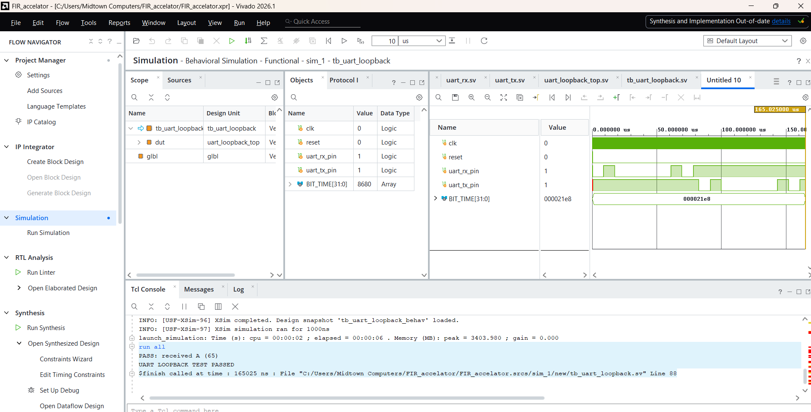

The repository also contains dedicated testbenches for the moving average, fixed filter, baseline/pipeline comparison, Python vectors and programmable coefficients. The original report records **213 Python-generated vector rows and 432 comparisons**, including pipeline flush checks. The saved simulator log in this package is the UART loopback run; earlier test totals are preserved as reported evidence.

### 6. Program and test the physical FPGA

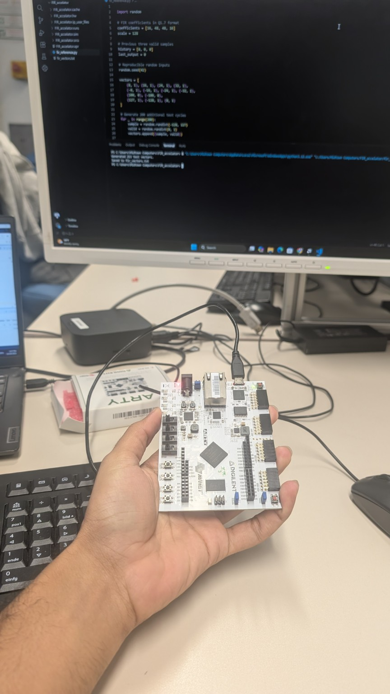

One USB cable supplies the board and exposes the JTAG programming and USB-UART interfaces. After generating the bitstream, the final `fir_uart_top` design is programmed using Vivado Hardware Manager.

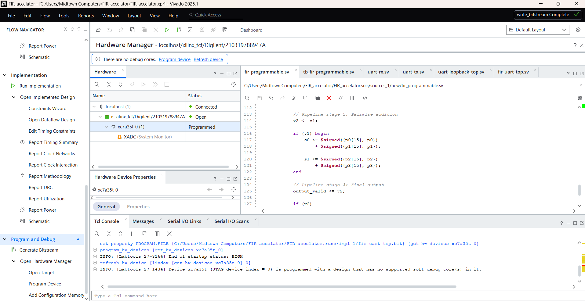

The Python hardware tests compare signed outputs to expected results. Loading equal-weight coefficients changes the response without rebuilding the design.

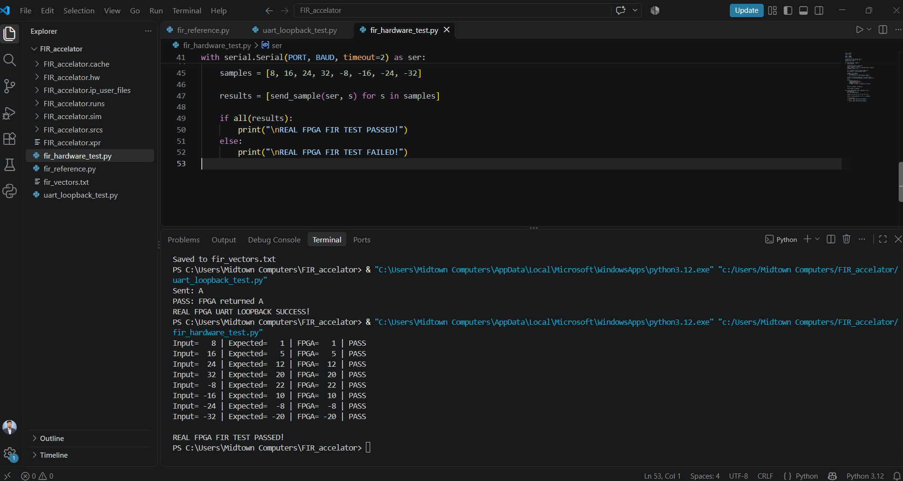

<details>
<summary>Coefficient update test and the reset lesson</summary>

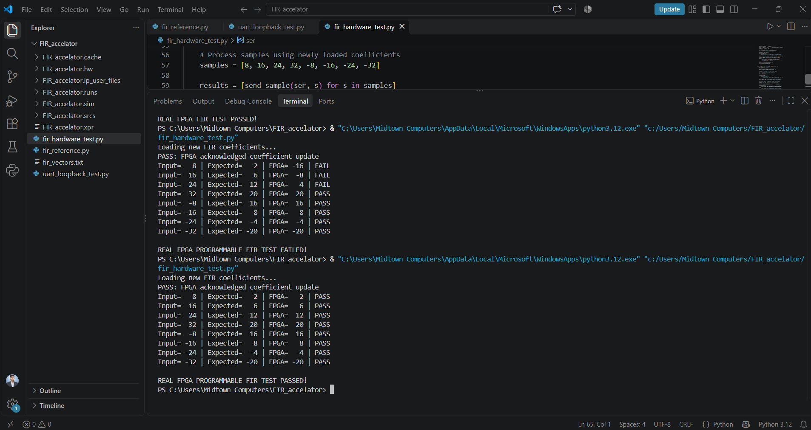

The first attempt had mismatched history between the host and FPGA. Pressing BTN0 before the fresh test synchronized their state, and the subsequent eight examples matched. Updating coefficients alone does not reset history.

</details>

### 7. Bring the hardware into FIR Studio

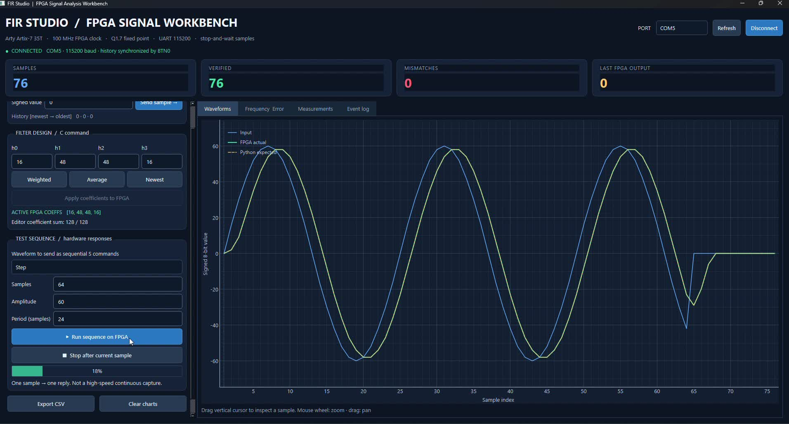

The final interface adds:

- Serial-port selection and connection-state reporting.
- Manual signed sample entry and runtime coefficient controls.
- Sine, square, triangle, impulse, step and seeded-random test sequences.
- Input, actual FPGA output and expected Python output on a shared plot.
- Per-sample PASS/FAIL comparisons, counters and measurement table.
- Calculated coefficient frequency response, error display and event log.
- CSV export and recovery guidance after a timeout or mismatch.

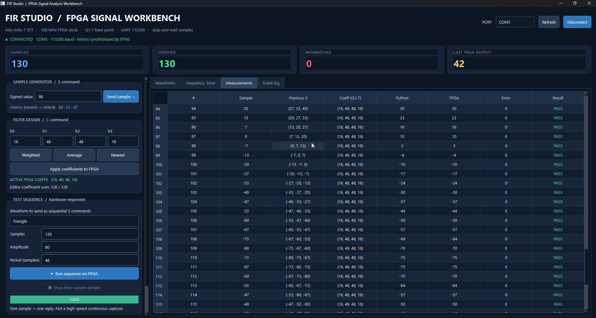

The recordings show matching results in multiple sessions, including a 130-sample comparison table. These sessions are not combined into a single test count. The frequency-response view is calculated from coefficients, rather than measured with external instrumentation.

## Final integrated implementation

The following figures describe **FIR + UART**, a different build from the standalone filter comparison above:

| Metric | Final saved implementation |
|---|---:|
| FPGA clock constraint | 100 MHz / 10 ns |
| LUTs | 229 |
| Registers | 210 |
| Slices | 85 |
| DSP48E1 blocks | 2 |
| Post-route setup WNS | +3.280 ns |
| Post-route hold WHS | +0.032 ns |
| Failing setup / hold endpoints | 0 / 0 |

Source: [timing report](docs/reports/fir_uart_top_timing_summary_routed.rpt) and [utilization report](docs/reports/fir_uart_top_utilization_placed.rpt). External I/O delay constraints are incomplete; these results establish the saved constrained-path timing, not a complete board-interface timing guarantee.

The core is pipelined, but the PC interface uses **one request followed by one response**. The 100 MHz internal clock is not a measured end-to-end UART sample rate.

## Run it yourself

1. Install Vivado with Artix-7 support and Python dependencies.
2. Recreate the project with `scripts/create_project.tcl`.
3. Run testbenches with `scripts/run_sim.tcl` and build with `scripts/build_bitstream.tcl`.
4. Program the matching board, press/release BTN0 and launch the GUI.

From the repository root:

```powershell
py -m venv .venv
.venv\Scripts\python.exe -m pip install -r requirements.txt
.venv\Scripts\python.exe software/fir_reference.py
.venv\Scripts\python.exe software/fir_interactive.py
```

**[Complete setup, simulation, programming and troubleshooting instructions →](docs/BUILD-AND-RUN.md)**

Use your board's COM port; COM5 was used in the original demonstration. After a hardware reset or communication error, disconnect and reconnect the GUI to resynchronize. **Clear charts does not reset the filter.**

## Repository guide

```text
rtl/                    Original SystemVerilog filter, UART and top-level modules
sim/                    Six testbenches and deterministic reference vectors
constraints/            Arty clock and board pin constraints
software/               FIR Studio, reference generator and hardware test scripts
scripts/                Portable Vivado project/simulation/build helpers
hardware/prebuilt/      Original integrated bitstream for the documented device
demo/                   Final showcase, web copy and full-length compressed recordings
docs/images/            README diagrams, selected screenshots and GUI captures
docs/evidence/          All 34 original screenshots and four hardware photographs
docs/reports/           Original PDF, saved final implementation reports and UART log
```

## Documents and evidence

- [Architecture, arithmetic and UART protocol](docs/ARCHITECTURE.md)
- [Build, simulation and hardware instructions](docs/BUILD-AND-RUN.md)
- [Results and evidence boundaries](docs/RESULTS.md)
- [Original 18-page project report](docs/reports/original-project-report.pdf)
- [Full-length recordings](demo/README.md)
- [Packaging changes and provenance](docs/PACKAGING-NOTES.md)
- [Publish with GitHub Desktop](docs/PUBLISHING.md)

The original PDF captures an earlier dashboard and development stage. This README describes the supplied final PySide6 application and keeps earlier measurements separate from the final integrated build. Hardware results are supplied project evidence; the project was not rerun on a physical board during packaging.

## Engineering concepts demonstrated

Fixed-point DSP, signed arithmetic and bit growth; sequential RTL and valid-signal alignment; pipeline resource/timing tradeoffs; UART FSMs; independent reference checking; FPGA synthesis and implementation; hardware/software state synchronization; and Python desktop visualization.

**Author: Anas Hussain** · Personal FPGA DSP and verification project.
